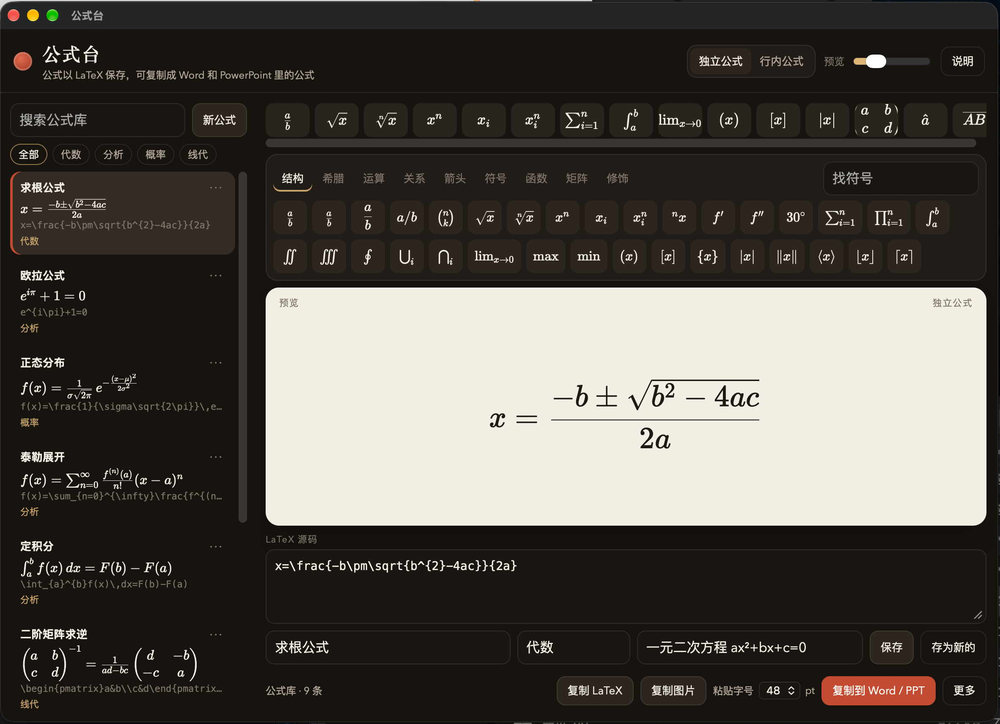

# 公式台

Mac 上的公式编辑器。公式以 LaTeX 保存在本机，可以复制成 Word 和 PowerPoint 里能继续编辑的公式，也可以复制成图片。



## 使用

从上面的模板栏点符号或结构，会插入对应的 LaTeX。方框 □ 是待填空位，直接输入会替换它，Tab 跳到下一个。先选中一段再点模板，会把选中的内容包进去。

左侧是公式库，可以搜索、按标签筛选、置顶和删除。第一次打开会放几条示例，可以改掉或删掉。

底部：

- **粘贴字号**：复制到 Word / PowerPoint 时的公式大小，从 10 pt 到 72 pt。
- **复制到 Word / PPT**：剪贴板里是 Office 公式，到文档或幻灯片文本框里按 ⌘V。上下标会按比例缩小。
- **复制图片**：白底、透明底或白字，适合不支持公式的软件。
- **复制 LaTeX**：源码本身。

常用快捷键：

| 快捷键 | 作用 |
| --- | --- |
| ⌘N | 新公式 |
| ⌘S | 保存当前公式 |
| ⌘⇧S | 存为新公式 |
| ⌘D | 切换独立公式 / 行内公式 |
| ⇧⌘W | 复制到 Word / PPT |
| ⇧⌘I | 复制图片 |
| ⇧⌘C | 复制 LaTeX |

公式库写在 `~/Library/Application Support/公式台/library.json`。菜单里可以导出、导入，或在访达中打开这个位置。

复制成可编辑公式需要本机已安装 Microsoft Word。程序会调用 Word 自带的转换表，不会把这份文件打进应用。没有安装 Word 时，仍可以编辑、保存，以及复制 LaTeX 和图片。

## 编译

需要 macOS 14 或更新版本、Xcode 命令行工具，以及 Node.js。

```bash
npm install
./build.sh
```

脚本会跑测试，并在源码目录的上一级生成 `公式台.app`。

## 隐私

公式台不联网，也不上传公式。编辑、公式库和复制都只发生在这台 Mac 上。复制到 Word 或 PowerPoint 时，内容进入系统剪贴板，由你粘贴到目标软件。

仓库里的界面截图只包含自带示例公式。本机公式库不在这个目录中。如果导出过带个人备注或未发表内容的 `library.json`，不要把它放进仓库。

## 依赖

界面排版使用 [KaTeX](https://github.com/KaTeX/KaTeX)（MIT）。LaTeX 转 MathML 使用 [Temml](https://github.com/ronkok/Temml)（MIT）。转成 Office 公式时使用本机 Word 安装目录中的 `mathml2omml.xsl`，该文件不随本仓库分发。
